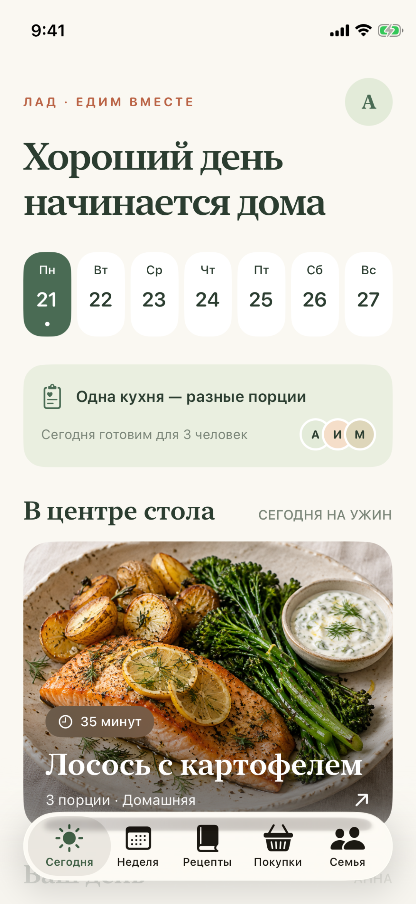
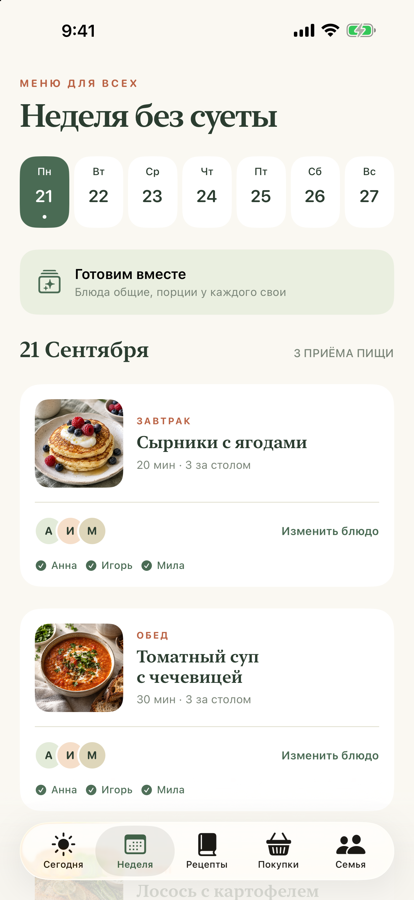
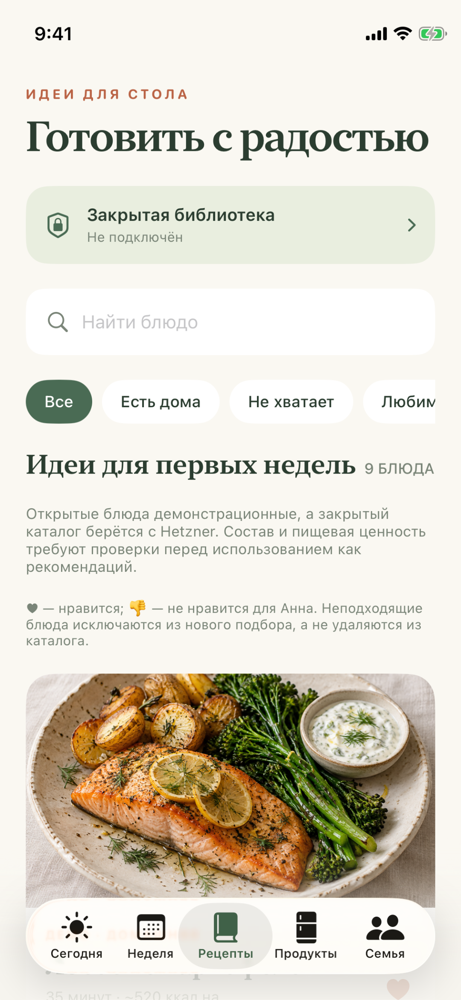
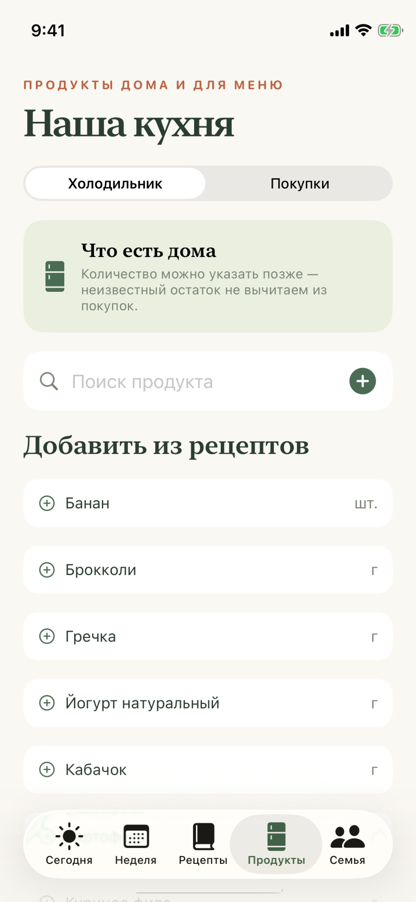
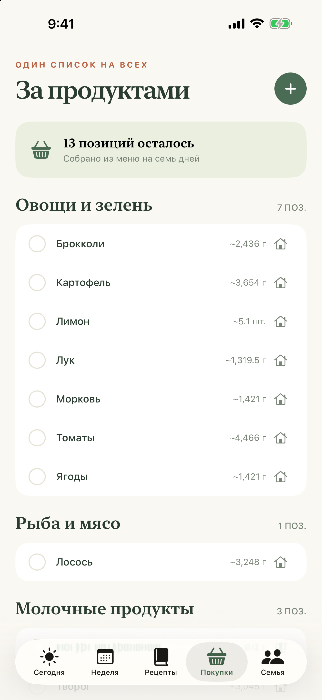
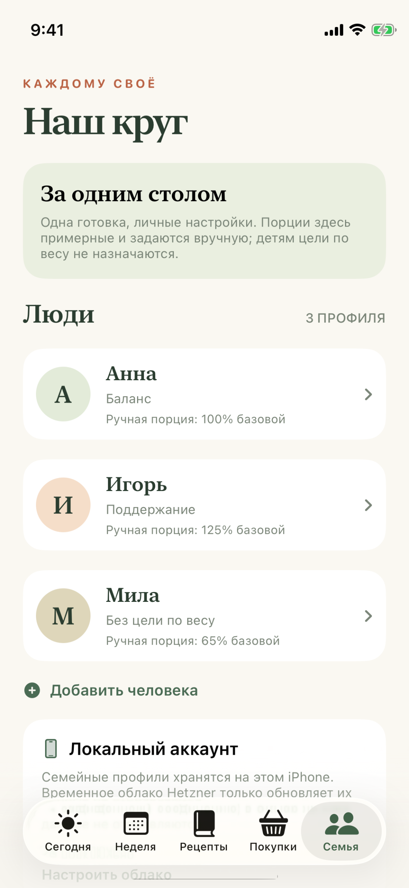

# Ladlekin — одна кухня, разные порции

Нативный планировщик питания для iPhone. Одна кастрюля, своя тарелка каждому. Под иконкой имя Ladlekin. В App Store: Ladlekin: Family Meal Planner / Ladlekin: Меню для семьи. Подзаголовок магазина на английском — One meal, different portions (28 символов); фраза One kitchen, different portions длиннее лимита Apple в 30 и стоит в рекламном тексте. Интерфейс и правовые документы доступны на английском, русском и украинском. Открытый каталог работает офлайн и обновляется по HTTPS. Исходники доступны публично, но **не распространяются по open-source лицензии** — см. [LICENSE](LICENSE).



| [Неделя](docs/screenshots/02-week.png) | [Рецепты](docs/screenshots/03-recipes.png) | [Холодильник](docs/screenshots/06-pantry.png) | [Покупки](docs/screenshots/04-shopping.png) | [Семья](docs/screenshots/05-family.png) |
| --- | --- | --- | --- | --- |
|  |  |  |  |  |

Работают семь дней меню, участники каждого приёма пищи, ручные порции и отметки съеденного. Нравится и не нравится стоят на карточке блюда. «Сегодня не хочу» предлагает замену для конкретного приёма пищи; меню и покупки меняются после подтверждения. По умолчанию включён один курс «Здоровое питание», его можно снять. В [`public-recipes.json`](Lad/public-recipes.json) лежит весь курс: 200 блюд офлайн, и у каждого своя кухня мира. Прежние публичные рецепты сохранены отдельно для чтения старых планов. Выбранные курсы становятся источником блюд и правил генерации, а не жёстким расписанием из бумажных недель; уже составленная неделя не меняется автоматически. Курсы можно сочетать с учётом настроек пользователя. Раздел «Продукты» учитывает остатки, сроки и недостающие ингредиенты. У 135 ингредиентов есть иллюстрации, описания и рекомендации по хранению на трёх языках. Пользователь может указать цену и размер упаковки для расчёта стоимости блюда; валюты не смешиваются.

К одному приёму можно вручную добавить несколько блюд из выбранного курса: их ингредиенты объединяются в покупках, а калории и микронутриенты суммируются для участника. Рецепты с `courseRole: side` предлагаются как дополнения, но не подменяют основное блюдо при автоматическом подборе. Напитки подбираются отдельно к еде с учётом сочетания, разнообразия, запасов и ограничений участников; они никогда не заменяют основное блюдо. В карточке приёма можно выбрать несколько напитков или убрать все. Только выбранные напитки входят в запасы, покупки, калории и нутриенты. Ручной выбор сохраняется при повторной генерации, алкоголь автоматически не предлагается. Старые планы с одним напитком продолжают читаться.

Обеды и ужины сохраняют назначение по первым документированным сочетаниям источника: они не переставляются автоматически или через ручной выбор. Завтраки выбираются из средиземноморской подборки. Ингредиенты, исходные/оценочные граммовки, выход и данные расчёта калорий сохранены. Тексты карточек подготовлены заново, примеры сочетаний пересобраны отдельно от порядка исходных страниц. Рекомендуемые часы — завтрак до 10:00, обед до 14:00, ужин 18:00–19:00; альтернативные крайние сроки остаются в пояснениях. Личное время приёмов не меняется. Перекус по желанию включается отдельно для человека и дня, если завтрака не хватило. Ориентир — за час до личного времени обеда; без личной настройки — 13:00 перед рекомендуемым обедом в 14:00. Три небольших варианта перекуса учитываются в продуктах, калориях и дневнике, отдельно от основных рецептов курса. При автоматических порциях энергия перекуса вычитается из дневного ориентира, а его размер не растёт вместе с основными блюдами.

Реклама в этой версии выключена. Разовая покупка `app.lad.complete` отключает рекламу, когда продажа включена. Курс из 200 блюд уже в приложении. Пока продажа не включена на сервере, покупка и «Восстановить покупки» в настройках скрыты. Целевой базовый ценник — $3; интерфейс показывает локализованную цену из StoreKit. Поддерживаются проверенные транзакции, восстановление и отзыв доступа после возврата. Данные профиля, дневника и веса рекламному SDK не передаются.

Реальные продажи и реклама ещё не запущены. В Debug используются тестовые идентификаторы AdMob; Release ожидает `LAD_ADMOB_APP_ID` и `LAD_ADMOB_BANNER_ID`. Покупка доступна только после настройки товара в App Store Connect и серверной проверки транзакций. Анонимный ответ `/v3/catalog` по-прежнему короткий. Приложение его не подставляет вместо полного курса, который уже лежит в сборке. Старый ключ пилота не является подтверждением покупки. Полный каталог и ключи Apple хранятся вне публичного репозитория.

## Запуск

Нутриенты в рецепте и итогах дня показывают четыре основных значения (белок, жиры, углеводы, клетчатка); кнопка «Ещё» раскрывает витамины и минералы вместе с пояснениями их роли. Возраст, рост, вес и выбранные аллергены находятся в начале профиля; выбор аллергенов и витаминных предпочтений свёрнут. Состав тела больше не запрашивается, но старые сохранённые измерения не удаляются.

«Порции по профилю» включаются отдельно. Для взрослых от 19 лет оценка энергии поддержания использует возраст, рост, вес, выбранные пол, активность и обычный взрослый контекст по [DRI Energy 2023, таблица 5-16](https://www.nationalacademies.org/read/26818/chapter/7). Ручной калорийный ориентир имеет приоритет; автоматический дефицит для похудения не назначается. Порции еды масштабируются по энергии полного дня с тремя основными приёмами и включённым перекусом (в пределах 0,5–3 базовых порций); энергия перекуса и напитков учитывается без автоматического увеличения их размера. Один расчёт используется для калорий, нутриентов, ингредиентов, готовки и покупок. При неполном профиле, плане или калорийности остаётся сохранённый ручной множитель. Взрослая формула не применяется к детям, беременности, кормлению и особому рациону; если масштабирование ограничено, в меню видна разница с ориентиром.

Откройте `Lad.xcodeproj` в Xcode, выберите схему `Lad` и iPhone Simulator, затем Run. Для физического iPhone требуется собственная команда разработчика и активный профиль подписи в Xcode. Исходный `project.yml` можно пересоздать через `xcodegen generate`; проект Xcode также сохранён в репозитории.

В локальном клоне включите проверку перед коммитом: `git config core.hooksPath .githooks`. Она запускает iOS-тесты и не допускает серверные/закрытые файлы в публичный индекс. Сервер и его тесты находятся в отдельной закрытой рабочей области.

Для проверки в терминале:

```sh
xcodebuild -project Lad.xcodeproj -scheme Lad -configuration Debug -destination 'generic/platform=iOS Simulator' CODE_SIGNING_ALLOWED=NO build
xcodebuild -project Lad.xcodeproj -scheme Lad -destination 'platform=iOS Simulator,name=iPhone 13 mini' CODE_SIGN_IDENTITY=- CODE_SIGNING_ALLOWED=YES CODE_SIGNING_REQUIRED=YES test
```

## Дневник, готовая еда и синхронизация

«Сегодня» позволяет записать фактически съеденные блюда, другую еду, дробную порцию, вес и время. Запись не меняет план и хранит снимок пищевой ценности, поэтому обновление каталога не переписывает историю. Готовая еда учитывается отдельными конечными партиями: можно отметить остаток на завтра, взять его в меню, съесть или разогреть без запуска готовки. Остатки покрывают соответствующую часть покупок; списание сырых продуктов при приготовлении требует отдельного подтверждения.

Отчёты доступны за день, неделю и выбранный период, отдельно по человеку или по всей семье. CSV содержит фактические порции, калории, нутриенты и способ разогрева; пустые значения остаются неизвестными. Экспорт и текст запроса для GPT / Claude передаются через системное меню «Поделиться», без автоматической отправки личных данных.

Напоминания включаются по желанию и следуют личному времени приёмов пищи; названия блюд и калории не выводятся на экран блокировки.

В «Семье» и настройках доступен «Вес и динамика»: отдельная история по человеку, периоды 7/30/90 дней и всё время, редактирование, удаление и CSV. Новое явное изменение веса в профиле записывается с текущей датой. Старое значение без даты не создаёт выдуманную точку. Последнее по дате измерение обновляет вес для порций; удаление точки не меняет текущий вес профиля. График не назначает цель похудения.

**Release / App Store:** данные питания, профилей и веса сохраняются локально в защищённом файле, исключённом из резервного копирования; iCloud для этих данных отключён. Это учитывает [правила Apple для данных о здоровье](https://developer.apple.com/app-store/review/guidelines/#health-and-health-research). Сохранённые данные прежнего пилота не удаляются автоматически. **Debug / личный пилот:** прежняя опциональная CloudKit-синхронизация дневника, меню, запасов и профилей сохранена, но история веса не отправляется и не берётся из облачного снимка. Debug нельзя распространять как магазинную версию. Отключение синхронизации не удаляет прежнюю облачную копию. Экспортируйте нужные записи перед удалением приложения или сменой телефона.

При повторном разогреве используются только применимые коэффициенты USDA R6. Разные приборы пока используют одну справочную модель; не задаются выдуманные точные потери для микроволновки, плиты и духовки. Минералы и макронутриенты не уменьшаются автоматически. Фактический вес сохраняется как отметка пользователя; без известного выхода готового блюда он не преобразуется в калории, расчёт идёт по указанной доле базовой порции.

## Понятные шаги готовки и карточка приёма (24 ноября 2026, сборка 23)

Все 523 шага 200 блюд курса переписаны простым кухонным языком на русском, английском и украинском. В каждом шаге названы посуда, огонь или температура духовки, время в минутах и признак готовности («зёрна мягкие, но целые», «нож входит легко»). Расплывчатые фразы («по упаковке», «в отмеренной воде», «до готовности», «при необходимости») убраны, как и редакторские пометки, которые не про готовку. Каждый шаг хранит свои минуты (`stepMinutes`); у 18 блюд общее время стало честнее: например, бурый рис варится 35–40 минут сам по себе. Тексты собирает и проверяет [`scripts/rewrite_steps.py`](scripts/rewrite_steps.py): в тексте нет граммов, у шага с огнём есть минуты, переводы не расходятся.

Приложение больше не дописывает к шагу шаблонные фразы, из-за которых появлялись «206,3 г», «столовая ложка соли» к рису и «включайте огонь» после варки. Под шагом теперь стоит отдельный список «Понадобится»: количества на всех за столом, округлённые как на кухонных весах (205 г, а не 206,3 г), и подсказка в стаканах или ложках. Продукт показан в том шаге, где его впервые берут в руки; слово относится к самому похожему продукту рецепта, поэтому «гречку» не путает с греческим йогуртом. К варке крупы без воды в составе добавляется вода по пропорции. Если шаг говорит «посолите», добавляется соль: полчайной ложки на стакан крупы, а для макарон и слива воды около чайной ложки на литр. Лимонный сок больше не считается жидкостью для варки.

На «Сегодня» рецепт открывается и с фото, и с названия: это одна зона нажатия со стрелкой. Четыре кнопки приёма заменены двумя: «Порция / съел другое» и меню «Заменить» (изменить блюдо, предложить другое, пропустить приём). Экран готовки стал спокойнее: полоска шагов, время шага, крупный текст, список «Понадобится» и кнопки внизу экрана.

## Порции без перебора (23 ноября 2026, сборка 21)

В сборке 19 порции подгонялись под всю дневную норму каждого. Но блюда курса лёгкие: день при одной порции даёт примерно 650–1 100 ккал. Из-за этого всё удваивалось: сырники на семью из четырёх выходили ×7,9 (почти 1,2 кг творога), а пятилетней доставалось полторы порции. Теперь тарелка следует за возрастом и целью (`profileShare`). Лёгкое меню дня поднимает её не больше чем на четверть (`PersonalPortions.maxMenuStretch = 1.25`, то есть тарелка взрослого на 1 600 ккал в день). Сытное меню по-прежнему уменьшает тарелку. Остаток дня закрывают перекус, фрукты или хлеб, а разницу показывает «Статистика». Для семьи «взрослая на снижении, взрослый, 10 и 5 лет» получается 1,06 + 1,25 + 1,0 + 0,81 ≈ 4,1 порции вместо 7,9 (было 3,3 до сборки 19). Тот же потолок действует и для включённых «Порций по профилю» взрослого.

В сборке 22 исправлена цена варёного риса: она считается от сухой упаковки с учётом выхода (1 г сухого ≈ 2,8 г варёного, по энергии USDA 365 и 130 ккал на 100 г), а не грамм в грамм. Два теста поиска томатов обновлены под «Вяленые томаты» из курса. Все 197 тестов проходят.

## Курс до 200 блюд и гарниры (23 ноября 2026, сборка 20)

Курс вырос со 163 до 200 блюд: 9 завтраков, 14 обедов и 14 ужинов. Новые блюда собраны только из продуктов, которые уже есть в курсе, поэтому у каждого есть нутриенты, иллюстрация и справочная цена. Гречки в новых блюдах нет: её в меню и так много. Данные и переводы лежат в [`scripts/course_200_dishes.py`](scripts/course_200_dishes.py), а [`scripts/expand_course_to_200.py`](scripts/expand_course_to_200.py) добавляет их в `public-recipes.json`, `Localizable.strings` и `Assets.xcassets` (`Menu200-*`). Повторный запуск ничего не меняет. Фото сгенерированы встроенным imagegen Codex по составу блюда, без референсных фотографий. Это иллюстрации, а не снимок точной порции.

Простые гарниры больше не подаются как отдельное блюдо: отварная гречка, отварная чечевица, гороховая крупа, пюре из цветной капусты, отварные яйца и яичница помечены `courseRole: side`. В сочетаниях, где они были основным блюдом, теперь стоит полноценное блюдо (например, куриные котлеты на пару), а гарнир предлагается рядом. «Гречка с помидорами» и другие блюда с гречкой остались основными.

## Порции семьи, статистика и покупки по дням (23 ноября 2026, сборка 19)

**Порции.** Доля по профилю (возраст, цель, введённые калории) раньше считалась от дня в 2000 ккал, а применялась к авторским порциям курса. Базовые порции курса дают всего 650–1100 ккал в день, поэтому дети с долей 65–80% получали несколько сотен ккал, а взрослый с включённым расчётом подгонялся под меню. Теперь любая доля по профилю переводится в порции фактического меню дня: например, Мария со «Снижением» получает ~1700 ккал, взрослый без цели ~2000, ребёнок 10 лет ~1600, ребёнок 5 лет ~1300. Соотношение между людьми сохраняется (85/100/80/65%). Завтрак, обед и ужин берутся из меню всей семьи, поэтому пропущенный обед в школе не раздувает остальные приёмы. День без полного меню берёт среднее по полным дням недели. Ручной размер, особый рацион, беременность и возраст до 2 лет используют заданный размер. В карточке блюда видно, на сколько порций написан рецепт и во сколько раз он умножен для всех за столом. У каждого человека показаны порции и калории, а на главной — «4 за столом» вместо прежнего ошибочного «4 порции».

**Скорость.** Объединённый список рецептов, расчёт плана и покупок, порции и ID рецептов курса теперь кэшируются по ревизии состояния и каталога. При подборе блюда запасы до этого приёма считаются один раз, а каждый кандидат проверяется только на своём приёме. «Нравится» больше не пересобирает неделю: было 6,5 с на симуляторе, стало меньше 1 мс. «Не нравится» заменяет блюдо только в открытых автоматических приёмах этого человека и выполняется после отрисовки нажатия. Полное заполнение недели — 1,3 с вместо 3,3 с.

**Статистика.** Кнопка «Статистика» рядом с аватаром на экране «Сегодня»: калории по дням с ориентиром, энергия из белков, жиров и углеводов, доля суточной нормы витаминов и минералов в среднем за день и блок «Чего не хватает». Нормы — RDA/AI Национальных академий США по возрасту и полу ([NIH ODS](https://ods.od.nih.gov/HealthInformation/nutrientrecommendations.aspx)). Белок — по весу для взрослых, клетчатка — 14 г на 1000 ккал. Для нехватки показаны три блюда выбранных курсов с наибольшим содержанием нутриента. Источник переключается между планом недели и дневником съеденного. Это ориентир по известным ингредиентам, а не анализ и не назначение добавок.

**Покупки по дням.** В «Продукты → Покупки» можно выбрать всю неделю или конкретный день. Для дня показаны меню (завтрак, обед, ужин, кто за столом) и список докупки только для открытых приёмов этого дня, с учётом запасов, уже отложенных на предыдущие приёмы. Неделя заполняется автоматически и при открытии «Продуктов».

## Каталог и закрытая библиотека

Бесплатные опубликованные программы доступны без регистрации. В Debug-пилоте раздел «Курсы» принимает HTTPS-адрес каталога, а «Закрытая библиотека» — личный ключ, хранящийся в iOS Keychain. Release отключает вход по пилотным ключам и загрузку закрытой библиотеки: это не механизм продажи цифровых курсов. Если закрытый рецепт недоступен, он не подменяется похожим открытым.

Серверный код, база, платные рецепты, семейные данные, закрытые изображения, ключи и импортные материалы ведутся отдельно от публичного репозитория приложения. Публичный JSON содержит 50 бесплатных блюд единого курса. Общий ключ старого пилота не подтверждает покупку: полный курс через `/v3/catalog` требует проверенной транзакции Apple. Черновики без проверенных критичных данных не должны попадать в автоматический рацион.

## Границы и план

Карточка показывает ингредиенты в метрических единицах, затем калории, белок, жиры, углеводы, клетчатку, витамины и минералы. Общая физиологическая роль каждого нутриента доступна на RU/EN/UK со ссылкой на NIH ODS или FDA; это не обещание эффекта отдельного блюда. Сведения о методике расчёта вынесены в раскрываемый блок.

Аллергены дополняются по распознанным ингредиентам (например, йогурт → молоко), без общей блокировки из-за старого флага каталога. Личные аллергии и действительно неуточнённый состав учитываются отдельно. Запасы, подбор и покупки используют одну метрическую единицу продукта; миграция бытовых мер сохраняет идентификатор партии и срок годности, приблизительные преобразования отмечаются `≈`.

Подготовка к App Store не заменяет редакционную и профессиональную проверку состава, технологии и прав на контент. Детские, медицинские и аллергенные сценарии требуют отдельного внимания. Неизвестные значения питания не считаются нулевыми. Приложение не назначает лечение, автоматический дефицит энергии или приём БАДов и не гарантирует похудение.

Витамины и минералы рассчитываются для ингредиентов с известной массой по [USDA FoodData Central SR Legacy](https://fdc.nal.usda.gov/download-datasets/). Для размеченных способов приготовления применяется [USDA Table of Nutrient Retention Factors, Release 6](https://www.ars.usda.gov/northeast-area/beltsville-md-bhnrc/beltsville-human-nutrition-research-center/methods-and-application-of-food-composition-laboratory/mafcl-site-pages/nutrient-retention-factors/). В каталоге можно передать `nutrientPreparations` — словарь «название ингредиента → raw/baked/sauteed/simmered/boiledDrained/fried/heated/toasted»; для 22 прежних блюд есть встроенная разметка, а новые закрытые карточки передают её с сервера. В приложении показаны источник и покрытие известной массы и готовки; для нутриентов без коэффициента готовки выводится только ориентир по сырому составу с пометкой о неполном расчёте. Неизвестные массы/продукты и широкие названия вроде «ягоды», «сыр», «фарш» ограничивают точность. Значения пересчитываются на выбранные порции и участников, но это не лабораторный анализ готовой еды и не персональная суточная норма. Исходные FDC ID и воспроизводимый генератор таблицы: `scripts/build_nutrient_reference.py`; расчёт нутриентов не устанавливает отметку «Исправлено с ИИ».

Фотографии открытых демонстрационных блюд и иконка созданы для проекта; [запросы для части снимков](docs/IMAGEGEN.md) сохранены отдельно. Закрытые изображения не входят в публичный репозиторий. Переписывание текста и новая иллюстрация сами по себе не подтверждают права на публикацию исходного рецепта: перед коммерческим релизом нужен отдельный правовой и редакционный аудит.

## Авторам курсов

Menudaro готовит площадку, где авторы смогут предлагать свои курсы за плату и получать договорное вознаграждение от продаж. Вместо статичного списка автор сможет представить структурированные рецепты и правила подбора; пользователи получат удобный способ составлять меню, учитывать порции и продукты и контролировать фактически съеденное.

Продажи авторских курсов и автоматические выплаты **ещё не запущены**. Первый магазинный выпуск предусматривает 50 бесплатных блюд и разовую покупку полного курса с отключением рекламы. Публикация сторонних платных курсов потребует подтверждения прав, проверки содержания и договора с автором. Доля автора, валюта, сроки, налоги и возвраты определяются договором; обещаний фиксированного дохода нет. Авторы не получают доступ к личному дневнику и данным здоровья покупателей.

Условия программы: [RU](Legal/ru/authors.md), [EN](Legal/en/authors.md), [UK](Legal/uk/authors.md).

## Пакет для App Store

В настройках → «О приложении» доступны условия, конфиденциальность, информация для авторов и источники. Исходники документов: [Legal](Legal). [Чек-лист выпуска](docs/app-store/RELEASE_CHECKLIST.md), [метаданные EN/RU/UK](docs/app-store/metadata.json), [заметки ревьюеру](docs/app-store/REVIEW_NOTES.md), [поддержка](docs/app-store/SUPPORT.md).

До отправки нужно заполнить [контакты и публичные URL](docs/app-store/release-config.json), разместить политику и поддержку на доступном сайте, проверить права на контент, App Privacy и реальные серверные журналы, пройти проверки release-сборки и оформить App Store Connect. Не используйте пилотный ключ для разблокировки платных функций. StoreKit checkout реализован и проверен локально; реальные продажи требуют товара App Store Connect и серверной настройки Apple. Репозиторий не содержит договора на выплаты авторам или подтверждённого юридического имени издателя.

Локальная проверка: `ruby scripts/check_store_release.rb --content-only` проверяет языки, длину метаданных, документы и версии. Без `--content-only` проверка также требует заполненных контактов и URL; она не заменяет ручной чек-лист и не выполняет отправку в магазин.

### Новые завтраки и перекус

Десять новых рецептов — самостоятельные вариации для приложения, отдельно от 103 блюд исходного домашнего курса. Данные для редактирования: [expanded-breakfasts.json](scripts/expanded-breakfasts.json); названия, инструкции и подписи переведены на EN/RU/UK. Все 18 завтраков входят в бесплатную подборку из 50 блюд. Прежние бесплатные блюда остаются доступными для сохранённых планов и дневника через legacy-каталог.

При подборе сочетаний использованы общие принципы [NHS Eatwell](https://www.nhs.uk/live-well/eat-well/food-types/starchy-foods-and-carbohydrates/) и [USDA MyPlate](https://www.myplate.gov/web/web/eat-healthy/protein-foods): крупы и хлеб, источники белка, овощи или фрукты. Рецепты не задают единую калорийную норму для всех. Правило опционального перекуса за час до обеда — выбранное владельцем поведение приложения; оно не заявлено как обязательная медицинская рекомендация.

Новые варианты на одну базовую порцию; калории и белок — расчётные ориентиры:

| Завтрак | ~ккал | ~белок, г |
| --- | ---: | ---: |
| Овсяноблин с творогом и томатами | 390 | 22 |
| Гречка с яйцом, грибами и шпинатом | 370 | 19 |
| Ночная овсянка с йогуртом и яблоком | 474 | 28 |
| Запечённая овсянка с творогом и яблоком | 461 | 27 |
| Тосты с творогом, огурцом и зеленью | 404 | 22 |
| Нут с яйцом, томатами и тостом | 415 | 21 |
| Чечевичные блинчики с йогуртом и огурцом | 369 | 28 |
| Горячие тосты с яйцом и моцареллой | 442 | 24 |
| Пшённая каша с тыквой и йогуртом | 441 | 23 |
| Тосты с запечённым лососем и авокадо | 402 | 21 |


## Расширение дефолтного курса и справочные цены, 25 октября 2026

Полный курс: 150 блюд — 27 завтраков, 71 обед и 52 ужина. При расширении 25 октября добавлены 9 завтраков и по 10 обедов и ужинов на основе существующих. Редакция 26 октября сохраняет все ID, ингредиенты, количества, порции, пищевые данные и назначения приёмов пищи. Для 103 исходных блюд и 3 базовых завтраков написаны новые RU/EN/UK инструкции; остальные 44 текста уже подготовлены отдельно для приложения. Подписи всех 150 карточек собраны из названий основных ингредиентов. Вместо прежнего порядка и пар составлены 56 новых примеров сочетаний; параметры часов и ограничений сохранены, их пояснения переписаны. Бесплатная подборка остаётся прежней: 50 блюд и 18 завтраков. Полный манифест и материалы авторинга хранятся вне публичного каталога. `scripts/expand_default_course.py` воспроизводит расширение из снимка владельца и создаёт проверку сохранности. Закрытая тестовая фикстура и оригиналы платных иллюстраций исключены из Git.

Для IL/UA/US включаемые справочные цены охватывают 33/20/13 категорий соответственно, за сентябрь 2026 года. Каждая запись хранит источник, период, категорию, физическую единицу и условия повторного использования. Цены пользователя всегда имеют приоритет; справочные записи не сохраняются в его личные покупки. Стоимость помечается приблизительной, валюта не конвертируется, пропуски не считаются нулём. Источники: CBS (лицензия коммерческого повторного использования), Держстат (CC BY 4.0, SDMX), BLS (public domain, API).

Обновление: `scripts/refresh_reference_prices.py --cache <owner-cache-directory>` получает официальные данные и атомарно формирует `Lad/reference-prices.json`. Серверный `LAD_PRICE_CATALOG` указывает на такой файл; новый публичный `/v3/prices` перечитывает его без перезапуска и не требует покупки или профиля здоровья. Кнопка обновления на iPhone использует этот endpoint и сохраняет последнюю корректную копию. Код и данные подготовлены локально; размещение серверного обновления и публикация в магазине отдельно не подтверждены.

Рабочий бренд Menudaro одинаков для EN/RU/UK; доступность товарного знака и права на исходный курс ещё не подтверждены. Ни название, ни локальные проверки не гарантируют позиции в поиске или одобрение App Review.

Название для текущего кандидата — **Menudaro** (менюда́ро; EN menu-DAH-roh), одинаковое написание на EN/RU/UK. Menulivo отклонено из-за сходства с действующим Menulio. В проверенных витринах App Store и точечных запросах открытого реестра Израиля совпадений Menudaro не найдено; это не полная проверка товарного знака. `menudaro.com` зарегистрирован, домен приложению не принадлежит. Архив и IPA 1.0.0 (4), подготовленные 25 октября, заменены текущей редакцией (5); API App Store Connect 25 октября вернул ноль карточек для bundle ID, загрузки в TestFlight не было. Итоги и ограничения: [аудит](docs/app-store/rights-and-naming-audit.json).

Редакция контента 26 октября воспроизводится скриптом `scripts/author_default_course.py` из закрытого снимка 25 октября и `../Lad-private/independent-course-copy-20261026.json`. Выходной файл — `../Lad-private/launch-catalog-20261026.json`; его следует использовать для будущего развёртывания полного курса. Запускайте этот этап после старого скрипта расширения, чтобы не вернуть прежние тексты. Исторические исходники и предыдущее оформление остаются в закрытом архиве. Составы и методы приготовления сами по себе не объявляются эксклюзивной интеллектуальной собственностью Menudaro. Новая редакция не является подтверждением лицензий на все входные материалы. [Текущий аудит контента](docs/app-store/content-origin-audit-20261026.json). Сервер и TestFlight этим этапом не обновляются.
